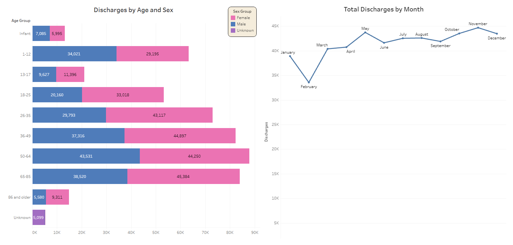
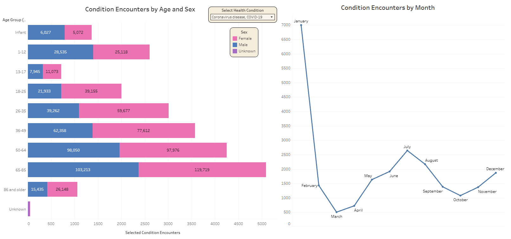
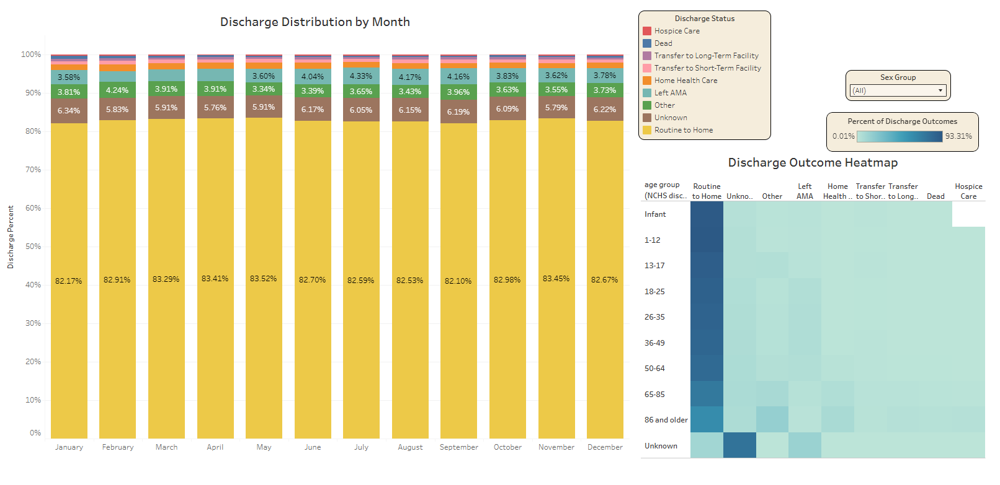

# Emergency Department Utilization Analysis

## 1. Introduction

Emergency departments must balance patient demand with available staffing and resources. Understanding patterns in encounter volume, patient demographics, health conditions, and discharge outcomes can help hospital operations teams make informed staffing and resource-planning decisions.

This case study analyzes 2022 emergency department (ED) data from the National Hospital Care Survey (NHCS), published by the National Center for Health Statistics (NCHS). For this project, the national survey data is treated as a simulated dataset representing an individual hospital's emergency department.

### Primary Business Question

**How do ED patient demographics, health conditions, discharge outcomes, and encounter volume vary throughout 2022, and what do these patterns suggest about staffing and operational planning?**

### Project Deliverables

- Business problem definition and analytical objectives
- Data source documentation and limitations
- Data preparation, cleaning, transformation, and validation using Python and SQL
- SQL views designed to answer specific business questions
- Tableau visualizations illustrating utilization patterns
- Findings and recommendations for emergency department operations

## Dashboard

Explore the interactive Tableau dashboard to examine emergency department data across age, sex, and time.

**[View the Interactive Dashboard on Tableau Public](https://public.tableau.com/app/profile/gerard.carrillo/viz/EmergencyDepartmentUtilizationAnalysis_17926855484100/Dashboard3#1)**

## 2. Data Source

This project uses the 2022 National Hospital Care Survey (NHCS) public-use emergency department data.

**Data source:** National Center for Health Statistics, Division of Health Care Statistics. *2022 National Hospital Care Survey (NHCS) Public Use Data Files.* 2026. Hyattsville, Maryland.

**Technical documentation:** National Center for Health Statistics, Division of Health Care Statistics. *2022 National Hospital Care Survey (NHCS) Technical Documentation.* April 2026. Hyattsville, Maryland.

- [NHCS Data and Documentation](https://www.cdc.gov/nchs/nhcs/data/index.html#cdc_data_description_data_use_and_impact-2022)
- [Dataset DOI](https://dx.doi.org/10.15620/cdc/252444)

The 2022 survey data originated from 213 nationally representative hospitals and contained approximately 11 million ED records before a systematic random 5% sample was selected. The resulting public-use dataset contains 497,769 records.

For this case study, the dataset is treated as representing a single hospital's ED. Survey weighting is not applied in the analysis.

### Data Confidentiality

The NHCS public-use data excludes personally identifiable patient information. The survey's technical documentation describes its data protection practices and applicable confidentiality procedures.

### Data Limitations

- **Time period:** The dataset covers 2022 only, preventing year-over-year comparisons.
- **Date granularity:** Only the month of discharge is available. Exact encounter dates, daily utilization patterns, wait times, and length of stay cannot be assessed.
- **Sampling and weighting:** The analysis uses sampled encounter records without applying survey weights. Results should not be interpreted as national population estimates or as actual counts from an individual hospital.

## 3. Tools and Technologies

| Tool | Purpose |
|---|---|
| Python and Pandas | Converted the original Stata file to CSV and inspected the data. |
| Google Colab | Provided the environment for file conversion and initial data inspection. |
| Google Cloud Storage | Stored the large CSV file for ingestion into BigQuery. |
| Google BigQuery and SQL | Stored raw data, created the cleaned analytical table, performed validation, and developed analytical views. |
| Tableau Public | Created visualizations to communicate findings and support operational recommendations. |

## 4. Data Preparation and Cleaning

### 4.1 File Conversion and Data Ingestion

The NHCS dataset was downloaded from the NCHS website in Stata format. Google Colab and Pandas were used to load the file into a DataFrame and convert it to CSV format.

The DataFrame was inspected before export to check the conversion. Because the resulting CSV exceeded 400 MB, it was uploaded to Google Cloud Storage and then loaded into BigQuery.

The original dataset was preserved during conversion. Subsequent cleaning and transformation were performed in SQL.

### 4.2 Selecting Relevant Fields

After loading the raw data into BigQuery, I reviewed the available fields and selected those relevant to the business question.

The analysis retained encounter identifiers, discharge dates, demographic information, discharge status, diagnosis codes, and Clinical Classifications Software Refined (CCSR) condition indicators.

The encounter identifier (`PUF_ID`) was retained for encounter-level analysis and validation. The year and discharge-month fields were also retained. A date field representing the first day of each discharge month was created to support chronological analysis and improve compatibility with Tableau.

### 4.3 Demographic Transformations

The original age, sex, and newborn fields were retained, with additional grouped fields created for analysis and visualization.

- Age was grouped into categories to support comparisons across age ranges.
- Sex and newborn indicators were converted into readable categories.
- Unknown or unclassified values were handled explicitly where applicable.

These transformations improved readability while preserving the underlying source fields.

### 4.4 Discharge Status

Discharge status was retained to examine how ED encounters conclude and identify differences across demographic groups.

A new field, `DISCHARGE_STATUS_GROUP`, translated the original coded values into readable categories:

- Routine discharge to home
- Left against medical advice (AMA)
- Transfer to a short-term facility
- Transfer to a long-term facility
- Home health care
- Hospice care
- Other outcomes
- Death
- Unknown status

The original coded field was retained alongside the grouped category to preserve source information.

### 4.5 Diagnosis Codes and Health Conditions

Individual diagnosis fields (`DX1` through `DX28`, along with additional diagnosis fields in the source schema) and CCSR condition indicators were retained for analysis.

Diagnosis fields support examination of recorded diagnoses, while CCSR indicators allow encounters to be categorized by selected health conditions. Descriptive labels were used to make analytical outputs easier to interpret.

CCSR indicators distinguish whether a condition is present, absent, or missing. Condition-based encounter counts include records where the relevant indicator identifies the condition as present.

An encounter may be associated with multiple conditions. Therefore, counts across different conditions are not mutually exclusive and should not be summed to calculate total ED encounters.

### 4.6 Excluded Fields

The raw dataset contained 91 columns related to encounter weighting. These fields were excluded from the cleaned analytical table because the project focuses on descriptive analysis of the sampled encounter records rather than weighted population estimates.

Consequently, the findings should not be presented as national population estimates. The NHCS technical documentation provides further details on the survey's sampling and weighting methodology.

## 5. Data Validation

After creating the cleaned table, I performed validation checks to assess whether the transformations preserved the records and produced a reliable foundation for analysis.

Validation included:

1. Comparing row counts between the raw and cleaned tables.
2. Checking encounter identifier uniqueness and investigating duplicate records.
3. Confirming that the reporting period covered 2022 and included all 12 months.
4. Reviewing the cleaning and recoding transformations.
5. Reconciling monthly encounter totals across analytical views.

The validation queries were saved separately to support documentation and reproducibility. The cleaned table served as the foundation for all subsequent SQL analysis.

**Supporting documentation:** See the SQL validation file in this repository for the queries used to perform these checks.

## 6. Analysis and Findings

The analysis was organized around four operational questions. SQL views were created in BigQuery to aggregate the cleaned encounter data at the appropriate level for each question. These views were then used to create Tableau visualizations.

### 6.1 Monthly Encounter Volume

**Business question:** How does ED encounter volume vary by month?

Monthly encounter counts were calculated to identify higher- and lower-volume periods throughout 2022.

Overall encounter volume remained relatively steady across the year. February had the lowest monthly count, while November had the highest. The February decline should be interpreted in the context of its shorter calendar length.

### 6.2 Demographic Utilization

**Business question:** How do ED encounters vary by age group and sex?

Encounters were grouped by discharge month, age group, and sex to identify demographic utilization patterns.

Key findings:

- Adults aged 18 and older accounted for approximately 80% of ED encounters.
- Monthly encounter counts among adult age groups remained relatively steady throughout the year.
- Pediatric encounters declined during the summer months, particularly among younger age groups, coinciding with school vacation.
- Infants and younger children experienced an increase in encounters during November.
- Female encounter counts were generally higher than male counts across adult age groups.

These patterns suggest that overall demand remained stable while certain demographic groups experienced seasonal variation.

### 6.3 Health Condition Trends

**Business question:** Which selected health conditions were most frequently recorded, and how did encounter counts change throughout the year?

Selected CCSR indicators were used to examine condition-specific encounter counts and monthly variation.

Key findings:

- COVID-19 encounters showed the most pronounced monthly spike in January, with 6,999 encounters. July was the next-highest month, with 2,644.
- Infectious disease and respiratory symptom encounters increased during November.
- Nausea and vomiting encounters increased from March through May.
- Superficial injuries and contusions were prevalent from May through August.

Because the dataset records discharge month rather than arrival month, the January COVID-19 spike cannot be attributed definitively to encounters beginning during December 2021 or the holiday season. The observed pattern identifies a period of higher recorded volume, but the underlying cause cannot be established from these data alone.

### 6.4 Discharge Outcomes

**Business question:** How do ED discharge outcomes vary across months and demographic groups?

Discharge outcomes were examined across age groups to identify differences in how encounters concluded.

Key findings:

- More than 90% of encounters involving children aged 17 and younger ended in routine discharge home.
- Among patients aged 86 and older, approximately 60% of encounters ended in routine discharge home.
- Older age groups had higher proportions of transfers to inpatient facilities, hospice care, and deaths.

These differences highlight the importance of considering patient age and discharge disposition when evaluating ED resource requirements. However, discharge outcomes alone do not establish the level of care required or whether additional staffing would improve outcomes.

## 7. Operational Recommendations

The findings support several considerations for emergency department staffing and resource planning. They identify patterns to investigate further rather than prescribing exact staffing levels.

- Plan around relatively stable overall demand. Monthly encounter volume remained relatively steady throughout 2022. Staffing decisions should account for baseline demand as well as changes in patient demographics and condition-specific encounters.

- Account for seasonal variation in pediatric encounters. Lower pediatric utilization during summer months and increased encounters among younger children in November suggest opportunities to review seasonal staffing and resource requirements.

- Prepare for changes in condition-specific demand. The January COVID-19 spike and increases in infectious disease and respiratory symptom encounters during November suggest that seasonal demand monitoring may help inform staffing and supply planning.

- Recognize the predominance of adult encounters. Since adults accounted for approximately 80% of encounters, adult care needs represent a substantial component of overall ED utilization. Staffing plans should also account for differences in acuity and resource requirements rather than relying on encounter volume alone.

- Consider the needs of older patients. Older age groups had lower rates of routine discharge home and higher proportions of transfers, hospice care, and death. These patterns support reviewing care coordination, discharge planning, and access to appropriate services for older patients. Resource decisions should be guided by clinical needs, patient acuity, and evidence of potential benefit rather than age alone.

The analysis provides a descriptive baseline for understanding ED utilization in 2022. Further analysis using encounter-level timestamps, acuity measures, staffing data, and multiple years of observations would be needed to develop more precise staffing forecasts and evaluate the impact of operational changes.

## 8. Tableau Dashboards

The following dashboards explore emergency department utilization patterns across 2022. Please click the link below to interact with the dashboards on Tableau Public directly.

**[View the Interactive Dashboard on Tableau Public](https://public.tableau.com/app/profile/gerard.carrillo/viz/EmergencyDepartmentUtilizationAnalysis_17926855484100/Dashboard3#1)**

